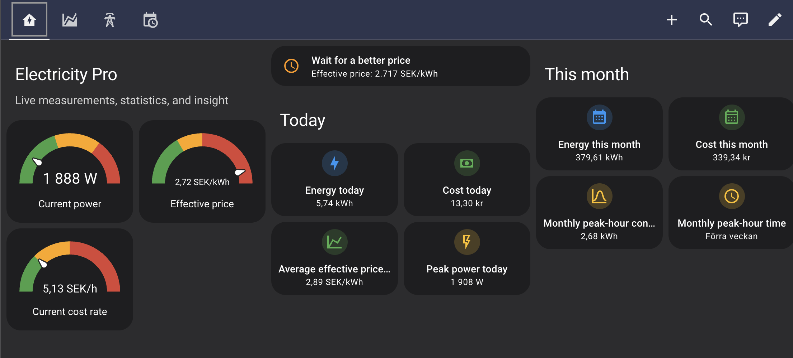
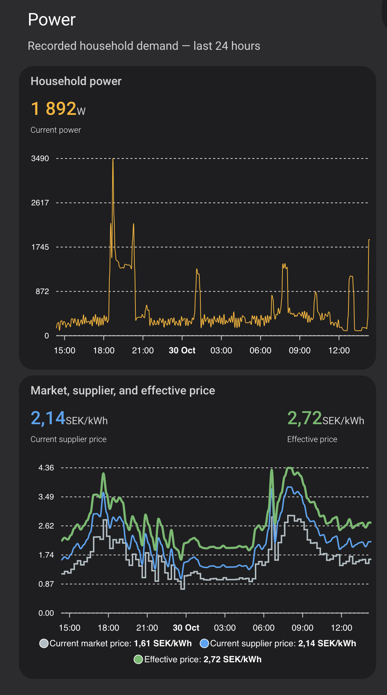
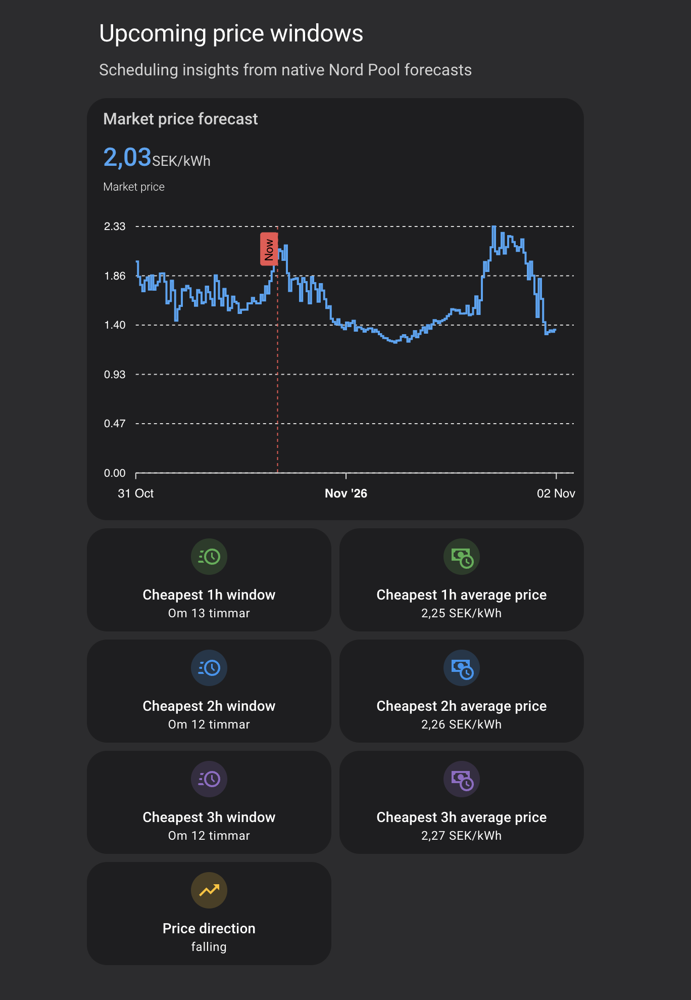

# Electricity Pro

**Understand your electricity use, see what it costs, and find better times to use it.**

Electricity Pro brings live power, energy totals, price insights and cost estimates
together in Home Assistant. It works with compatible sensors you already have
and complements the native Energy Dashboard—you do not need solar panels or a
battery to get started.

[Install with HACS](#hacs-installation-recommended) ·
[Configure your sources](docs/README.md#configuration) ·
[Add a dashboard](examples/dashboards/README.md#quick-installation)

**Stable: [v1.5.2](https://github.com/guslund-jpg/electricity-pro/releases/tag/v1.5.2).**
This README also covers unreleased development; see [release scope](#release-scope)
before installing code or examples from `main`.

*A real, user-configured Enhanced dashboard. It requires Mushroom and ApexCharts
Card; the [Standard dashboard](#dashboard) uses only built-in Home Assistant cards.
This installation retains older labels: “Cost today/month” shows supplier costs,
not total household costs. Current examples distinguish supplier costs from total
cost estimates. Layout, language and readings vary by installation.*

## Who is Electricity Pro for?

For Home Assistant users who want to answer practical questions:

- **What am I using and spending?** See live power, today's and this month's
  energy, and cost estimates based on the sources and charges you configure.
  Partial coverage and excluded charges remain explicit; estimates are not bills.
- **Is now a good time to use electricity?** Use a fixed price threshold or
  opt-in Adaptive Good Time, and compare upcoming cheapest 1h, 2h and 3h windows
  when a native Nord Pool forecast is available.
- **How can I act on this?** Add the sensors to a dashboard or use them in your
  own Home Assistant notifications and automations. Electricity Pro does not
  start appliances or control a battery for you.

## Why Electricity Pro?

Keep the Energy Dashboard for its overview and use Electricity Pro for live
cost context, timing insights and sensors you can build on. Compatible Home
Assistant entities provide the inputs; the calculations are not tied to one
meter or electricity supplier.

Choose **Tibber fast track** when Tibber supplies both your contracted price and
Pulse measurements, or **Custom or mixed sources** for other compatible entities.
Forecast insights use Home Assistant's native Nord Pool integration. Grid fees,
taxes and fixed fees are optional inputs: adding the applicable charges makes
cost estimates more complete.

Have a recent electricity-supplier bill and grid-provider bill available during
configuration. See the [configuration guide](docs/README.md#configuration) for
source requirements and price-component definitions.

---

## Release scope

The latest stable release is [v1.5.2](https://github.com/guslund-jpg/electricity-pro/releases/tag/v1.5.2).
It contains the v1.5.1 reliability improvements and a focused startup-timezone
fix. See the [upgrade notes](docs/releases/1.5.2.md).

Documentation on `main` also describes unreleased development. Optional
production/export/household sources, compatibility diagnostics, automatic VAT
suggestions and Tibber forecast-addition estimation are **not in v1.5.2**.
Use a separate test installation for development code; solar/battery hardware
validation remains outstanding.

The [draft v1.6 release notes and checklist](docs/releases/1.6.0.md) distinguish
implemented changes, proposed usability additions and outstanding release gates.
They are not a release announcement.

## Features

### Live Monitoring

Monitor your home's energy usage in real time.

Current Power represents signed net-grid power: positive means import and
negative means export. Export compensation is not inferred from import prices.

- Current Power
- Energy Today
- Energy This Month
- Current Electricity Price
- Current Market Price when a Nord Pool forecast source is configured
- Average Market Price Today for long-term retrospective market statistics;
  it is not used for recommendations
- Effective Price
- Current Cost Rate
- Cost Today
- Consumption-Weighted Average Price Today
- Cost This Month
- Peak Power Today
- Current L1 / L2 / L3
- Voltage L1 / L2 / L3
- Monthly Peak Hour Consumption
- Monthly Peak Hour Time.

### Insights

- Consumption Timing Score Yesterday compares when electricity was consumed
  with yesterday's relative Effective Prices (available after a sufficiently
  complete day of observations)
- Good Time to Use Electricity using either the existing fixed Effective Price
  threshold or an opt-in adaptive comparison with similar historical hours
- Cheapest upcoming 1h window start (Nord Pool forecast)
- Cheapest upcoming 2h window start (Nord Pool forecast)
- Cheapest upcoming 3h window start (Nord Pool forecast)
- Average scheduling price for each cheapest 1h, 2h and 3h window. This is the
  Nord Pool market price plus the configured supplier markup, variable grid
  fee, and Energy Tax,
  not a complete household Effective Price.
- Next inexpensive 1h window start only when the forecast and live Effective
  Price have comparable, complete component scopes
- Price direction (Nord Pool forecast)

### Native Home Assistant Integration

- Standard sensor entities
- Recorder compatible
- Long-term statistics compatible
- Automation friendly
- Dashboard friendly

### Built for Reliability

- Native Home Assistant integration
- Automated testing
- Continuous Integration
- Open architecture
- Contributor friendly

---

## Roadmap

Electricity Pro is evolving in carefully planned stages.

| Release    | Focus                             | Status            |
| ---------- | --------------------------------- | ----------------- |
| **v0.6**   | Foundation                        | Released          |
| **v0.7**   | Traditional Sensors & Statistics  | Released          |
| **v0.8**   | Intelligence                      | Released          |
| **v0.9**   | Daily Statistics & Dashboards     | Released          |
| **v1.0**   | Stable Release                    | Released          |
| **v1.1**   | Forecast Prices & Scheduling      | Released          |
| **v1.2**   | Pricing & Tariff Foundation       | Released          |
| **v1.3**   | Recommendation Intelligence       | Released          |
| **v1.4**   | Market Price Intelligence         | Released          |
| **v1.5**   | Adaptive Price Intelligence       | Released          |
| **v1.5.2** | Startup Timezone Fix              | Released          |
| **v1.6**   | Production & Bidirectional Energy | In development    |
| **v1.7**   | Flexible-Load Recommendations     | Future            |
| **v1.8**   | Storage & Whole-Home Optimisation | Future            |

See [ROADMAP.md](ROADMAP.md) for more details.

---

## Dashboard

Start with the **Standard dashboard**. It uses only cards included with Home
Assistant and covers live measurements, daily and monthly statistics, Effective
Price, current market-price context, and scheduling and retrospective insights.

| Example      | Recommended for                         | Additional requirements      |
| ------------ | --------------------------------------- | ---------------------------- |
| **Standard** | Most users and first-time setup         | None                         |
| **Enhanced** | Richer presentation and forecast charts | Mushroom and ApexCharts Card |

HACS installs the integration but cannot add a dashboard automatically. The
[one-minute dashboard guide](examples/dashboards/README.md#quick-installation)
links directly to both ready-to-copy YAML examples.

### Explore prices and timing

These real Enhanced dashboard screenshots show two complementary views. Select
an image to open it at full size.

| Recorded power and price comparison | Upcoming prices and cheapest windows |
| ---------------------------------- | ------------------------------------ |
|  |  |

The power chart uses Current Power (net grid import/export), despite the older
“Household power” title; it is not the separate optional household-demand sensor.
The forecast chart shows market prices, while window averages include configured
supplier additions, variable grid fees and energy tax. They need not match the
chart's market-price level. Price direction compares individual intervals, not
a smoothed hourly trend. Screenshots show one installation's readings and
Swedish formatting, not guaranteed costs or savings.

---

## Automation examples

Start with an [opt-in cheapest-window reminder](examples/automations/README.md)
for a 1h, 2h or 3h window. The same separately installed package includes an
explicitly requested appliance-action **dry run**—it only sends a notification
until you deliberately configure a supported device action.

Requests have an average-price ceiling and cancel when the selected window
changes before starting. They do not resume after a restart or silently catch
up on missed starts. Review the guide's freshness limitations and test the dry
run before connecting a real appliance. EV charging control remains future work.
These examples are not installed or enabled by HACS.

Additional [notification and Good Time examples](examples/automations/followups.md)
cover a daily best-currently-available window notice, a next-inexpensive-hour
reminder, and a humidity/dehumidifier simulation with separate start/stop
thresholds and unavailable-input handling. No real-device control is enabled.

## Installation

### HACS installation (recommended)

Electricity Pro requires Home Assistant 2025.9.0 or newer.

Electricity Pro currently supports installation as a HACS custom repository:

1. Open HACS in your Home Assistant sidebar.
2. Open the menu and select **Custom repositories**.
3. Add `https://github.com/guslund-jpg/electricity-pro` with category
   **Integration**.
4. Open **Integrations**, search for **Electricity Pro**, and download it.
5. Restart Home Assistant.
6. Add **Electricity Pro** from **Settings → Devices & Services**.

Forecast insights additionally require Home Assistant's native Nord Pool
integration to be configured. They do not use the older HACS Nord Pool custom
integration. Electricity Pro inherits the native integration's currency and,
for single-area entries, its price area automatically. It asks for an area only
when the selected Nord Pool entry contains several.

Holiday-aware high/low grid tariffs optionally require Home Assistant's
**Workday** integration. Configure Workday for your country and exclude
holidays, then select its binary sensor in the Electricity Pro options. Workday
is not required when you use a constant grid fee or do not need holiday
exceptions.

### After installation: find your data

Electricity Pro creates Home Assistant entities; it does not replace or modify
your dashboards automatically. Find all available values under **Settings →
Devices & services → Electricity Pro → Entities**. From there, individual
entities can be added to any existing dashboard.

Two optional, ready-to-copy dashboard examples are maintained in
[`examples/dashboards`](examples/dashboards/README.md):

- **Recommended:** [`electricity-pro.yaml`](examples/dashboards/electricity-pro.yaml)
  uses only cards built into Home Assistant.
- [`electricity-pro-enhanced.yaml`](examples/dashboards/electricity-pro-enhanced.yaml)
  adds Mushroom and ApexCharts Card presentation.

Dashboard YAML is not installed or imported by HACS. Follow the
[dashboard installation guide](examples/dashboards/README.md#quick-installation) to
create a manual dashboard, copy an example, and verify its entity IDs.

### Manual installation

1. Copy the `custom_components/electricity_pro` folder into your Home Assistant configuration.
2. Restart Home Assistant.
3. Add **Electricity Pro** from **Settings → Devices & Services**.
4. Choose **Tibber fast track** when Tibber provides both the contract price and
   Pulse measurements. Otherwise choose **Custom or mixed sources**, select the
   compatible Home Assistant entities, and declare the selected price source's
   included components and VAT treatment. VAT-excluded prices and native Nord
   Pool forecasts also need an explicit VAT percentage; see
   [VAT configuration and upgrade guidance](docs/vat-pricing.md).

See the [configuration guide](docs/README.md#configuration) for source examples,
grid-tariff settings, and optional Nord Pool and Workday features.

Forecast features use the native Home Assistant Nord Pool integration. The
legacy HACS Nord Pool integration is not required or supported as a forecast source.

---

## Documentation

- [Configuration and project guide](docs/README.md#configuration)
- [Optional production, export and household demand (unreleased)](docs/production-export.md)
- [Installation and power compatibility diagnostic (unreleased)](docs/flow-compatibility.md)
- [v1.6 synthetic test lab and release evidence](examples/testing/README.md)
- [Recorder and database-write guidance](docs/README.md#recorder-and-database-writes)
- [Roadmap](ROADMAP.md)
- [Architecture](docs/architecture.md)
- [Contributing](CONTRIBUTING.md)
- [Changelog](CHANGELOG.md)

---

## Project Vision

Electricity Pro aims to turn fragmented household electricity data into one
provider-independent view of usage and cost. It is designed to be:

- **P1/HAN meter and dongle independent.** Electricity Pro consumes compatible
  Home Assistant entities instead of tying its analytics to one meter product.
  Tibber Pulse, P1IB, HomeWizard P1 Meter, and Athom Homey Energy Dongle are
  examples of possible sources when their Home Assistant integrations expose
  measurements with the required meaning and units.
- **Electricity-supplier independent.** Supplier prices, per-kWh markups, and
  fixed supplier fees are treated as explicit inputs rather than assumptions
  about one retailer.
- **Grid-provider independent.** Variable grid charges, time-of-use schedules,
  fixed grid fees, and holiday rules can be described without provider-specific
  calculation branches.
- **Spot-market independent in its data model.** Live market prices can come
  from any compatible Home Assistant price entity. Forecast insights currently
  use Home Assistant's native Nord Pool integration; support for other markets,
  such as EPEX SPOT, requires a compatible forecast source.

The path from meter to electricity bill differs by country and household.
Meters, suppliers, grid operators, and spot markets expose different sensors,
APIs, tariffs, markups, and fixed charges. Regulated taxes and VAT add another
layer. Electricity Pro normalizes these inputs and combines only components
whose meaning is known, aiming to get as close as the available data permits to
the household's true electricity cost.

That cost model supports clearer statistics, better scheduling insights, and
reliable inputs for Home Assistant automations. Most price and tariff details
are optional: Electricity Pro remains useful with a compatible power source and
spot price, which is often the largest time-varying component. Adding the
applicable supplier, grid, and tax information makes cost-based results more
complete. Missing components remain explicit rather than being silently
guessed.

Some capabilities may initially support a narrower source when that allows a
reliable first implementation, but the underlying contracts should remain
provider-independent.

---

## Project Status

### Current release

v1.5.2 – Startup Timezone Fix

This focused maintenance release builds on v1.5.1 and reuses Home Assistant's
loaded timezone during setup/reload. Read the
[release and upgrade notes](docs/releases/1.5.2.md) before upgrading.
It does not include the unfinished v1.6 features on `main`.

Electricity Pro is actively developed with a clear public roadmap.

The next roadmap phase is v1.6, with independent measured production/export and
household channels already implemented on main but not yet released.
Device-specific optimisation follows only after those energy-flow and pricing
contracts are reliable.

---

## Contributing

Contributions, ideas and feedback are always welcome.

Please read [CONTRIBUTING.md](CONTRIBUTING.md) before opening a pull request.

---

## License

This project is released under the MIT License.
