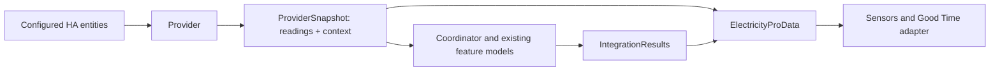

# ADR-0014: Separate source readings and integration results

## Status

**Accepted. All three stages are implemented and the configured development
instance passed the manual continuity and tariff checks.**

Date: 8 November 2026. Reviewed source baseline: `4cb72d1`.
The maintainer approved this design and its documentation PR #390 on
8 November 2026. This document records the next bounded architecture change in
[#288](https://github.com/guslund-jpg/electricity-pro/issues/288).
The provider boundary, result composition and consumer migration are implemented
as described below. This is source maintenance, not a release commitment or a
claim of completed manual HA verification.

## Summary

Give the immutable runtime snapshot three explicit groups: normalized source
readings, resolved calculation context and integration results. The provider
produces the first two. The coordinator composes the third through the existing
calculations and feature models. Entities consume the assembled snapshot.

Deliver this in **three implementation PRs**: establish the
provider boundary, separate result composition, then migrate consumers and remove
the transitional flat views. Additional small history extractions are optional
follow-ups, rather than prerequisites for this sequence.

## Problem

At the reviewed base, `ElectricityProData` has **51 fields**. The provider
constructs it with source values, resolved settings and empty result slots; the coordinator can
replace **30 fields** through `_DataUpdates`. Sensors and the Good Time adapter
import this shared type from `provider.py`.

Four field names serve two different roles:

- `current_energy` and `current_energy_unit` are a source register in a provider
  read, but the published Energy Today value after lifetime-counter processing.
- `accumulated_cost_today` and `accumulated_cost_today_unit` are an external cost
  source in a provider read, but the selected external or local supplier cost
  after coordinator composition.

The distinction matters for meter-reset protection, cost authority and missing
data. Fixed fees also look like results by name, although their amounts come
from settings. Source/result ownership needs an explicit contract rather than
classification by field-name prefixes.

The existing snapshot-backed sensor attribute branches were moved to descriptions
in #386–#388. #389 extracted completed base-load summaries and their rolling
result. The remaining monthly-energy attribute case deliberately uses public
coordinator metadata. Those boundaries remain in place during this work.

## Homeowner question and user impact

The maintenance question is: will my readings, costs, automations and retained
history keep their established meaning as the integration evolves?

This change improves internal ownership and reviewability. Expected user-visible
values, availability, attributes, naming, IDs and settings stay the same.
It adds no dashboard controls, accounting capability or performance promise.

## Goals

- Preserve source values independently of the values selected for publication.
- Give every existing field an explicit input, context or result owner.
- Keep normalized inputs immutable while computing results with existing rules.
- Complete the migration with one canonical snapshot, explicit typed access and
  removal of the temporary flat views.
- Preserve stored formats, source scoping, clocks, update ordering and HA identity.

## Non-goals

This proposal does not move every history out of the coordinator, introduce a
generic tracker framework, change cost/pricing algorithms, repair old totals or
alter configuration flows. Forecasts, optional flow channels and their diagnostics
retain their separate models. Real solar/battery evidence remains tracked in
[#335](https://github.com/guslund-jpg/electricity-pro/issues/335).

Calculation helpers currently invoked by entities, including Effective Price,
Current Cost Rate and Remaining Cost Today, retain their current evaluation
location and timing. Relocating or caching them would be a separately reviewed
behavioral decision.

## Design

Place the shared data contracts in a pure `data.py` module. The agreed names
below describe the target; none of these new types exists at the reviewed base.
Stage 1 introduces `SourceReadings`, `CalculationContext` and `ProviderSnapshot`.
It moves the unchanged flat `ElectricityProData` into the same module with a
temporary explicit re-export from `provider.py`. Stage 2 adds `IntegrationResults`
and moves coordinator reads/history helpers to the canonical inputs. Stage 3
publishes the grouped aggregate and migrates consumers. The final provider
entry point is `read()`, returning only `ProviderSnapshot`; the transitional
`read_inputs()` name, flat model, re-export and both legacy views are removed.

| Type | Responsibility |
| --- | --- |
| `SourceReadings` | Normalized measurements, source units and existing source semantics |
| `CalculationContext` | The seven already-resolved pricing/settings values currently carried in the snapshot |
| `ProviderSnapshot` | Immutable pair of readings and context from one provider read |
| `IntegrationResults` | Derived and selected values, including authoritative external pass-through values |
| `ElectricityProData` | Final immutable aggregate with `readings`, `context` and `results` |

Use frozen, slotted data classes with explicit optional types. Keep unknown values
as unknown; introduce no additional numeric conversion, validation or defaulting
through the new containers. Existing normalization and calculation boundaries
continue to validate their inputs.

### Field inventory: source readings

The 14 input-only fields keep their existing names inside `SourceReadings`.

| Existing fields | Meaning |
| --- | --- |
| `current_power`, `current_power_bidirectional` | Signed power and the existing bidirectional marker |
| `current_price`, `current_price_unit` | Normalized live price source |
| `energy_source_type` | Existing daily/lifetime declaration associated with the energy reading |
| `current_l1`, `current_l2`, `current_l3` | Normalized phase-current readings |
| `voltage_l1`, `voltage_l2`, `voltage_l3` | Normalized phase-voltage readings |
| `monthly_peak_hour_consumption`, `monthly_peak_hour_consumption_unit`, `monthly_peak_hour_time` | Configured external peak-hour readings, not the integration's monthly accumulator |

Add four explicitly named source fields for the dual-role pairs. Their published
counterparts remain separate in `IntegrationResults`.

| Existing provider field | Proposed source field |
| --- | --- |
| `current_energy` | `import_energy_value` |
| `current_energy_unit` | `import_energy_unit` |
| `accumulated_cost_today` | `external_cost_today` |
| `accumulated_cost_today_unit` | `external_cost_today_unit` |

This gives **18 source fields**. Preserve the provider's currently supported
Wh/kWh handling; a lifetime register must never be replaced by the derived daily
delta in this group.

### Field inventory: calculation context

These **seven fields** retain their existing values and optionality.

| Existing fields | Meaning |
| --- | --- |
| `pricing_metadata` | Resolved live-price contract, components, VAT and completeness |
| `grid_fee_per_kwh`, `supplier_markup_per_kwh`, `energy_tax_per_kwh` | Resolved variable adjustments; the grid fee retains its current tariff-time evaluation |
| `fixed_supplier_fee_this_month`, `fixed_grid_fee_this_month` | Configured monthly fee amounts, distinct from accrued household fees |
| `good_price_threshold` | Existing normalized fixed threshold |

Keep other settings at their current owners. Do not expand this into a second
saved-settings schema or a new settings cache. Currency units inferred from the
selected cost/price belong to results, not to the configured fee amounts.

### Field inventory: integration results

These **30 fields** correspond exactly to the existing `_DataUpdates` keys.
Keep their names within the result group to limit unrelated naming changes.
Preserve the value types and unknown/default meanings from `ElectricityProData`.
Some `_DataUpdates` annotations are narrower, such as `Decimal` for a field whose
snapshot type is `Decimal | None`. Keep that update contract separate; copying
its annotations into the result schema would discard valid missing states.

| Existing fields | Meaning |
| --- | --- |
| `current_energy`, `current_energy_unit`, `energy_today_period_complete` | Selected/published Energy Today and its completeness |
| `accumulated_cost_today`, `accumulated_cost_today_unit` | Selected supplier cost today, retaining external authority |
| `peak_power_today`, `peak_power_time_today` | Locally tracked daily peak |
| `energy_this_month`, `energy_this_month_unit` | Protected monthly import total |
| `cost_this_month`, `cost_this_month_unit` | Selected/accumulated monthly supplier cost |
| `fixed_supplier_fee_this_month_unit`, `fixed_grid_fee_this_month_unit` | Existing currency inference for fixed-fee sensors |
| `total_supplier_cost_this_month`, `total_supplier_cost_this_month_unit` | Existing supplier total including its fixed fee |
| `local_cost_estimate`, `local_effective_cost_today`, `local_priced_energy_today`, `local_supplier_energy_today`, `local_supplier_energy_month` | Existing local-estimate provenance and distinct effective/supplier coverage |
| `household_cost_today`, `household_cost_this_month`, `household_cost_unit` | Existing partial household totals |
| `household_variable_today`, `household_variable_month` | Household variable amounts |
| `household_fixed_today`, `household_fixed_month` | Accrued fixed amounts |
| `household_priced_energy_today`, `household_priced_energy_month` | Household priced-energy coverage |
| `household_missing_fees` | Existing missing-component tuple |

The inventory covers all **51 distinct existing fields**: 14 input-only,
7 context-only, 26 result-only and 4 dual-role fields. Splitting those four roles
produces 18 source fields, 7 context fields and 30 result fields. The extra four
slots express different meanings, rather than two writable copies of one value.

### Authority and ordering

- Daily energy sources pass through using their existing value/unit semantics.
  Lifetime sources feed protected daily/monthly processing and the existing cost
  ledger. A rejected dip/reset must still prevent that reading reaching the ledger.
- A configured external daily-cost source stays authoritative when unavailable.
  Its absence of a reading must not enable local-estimate fallback.
- Initialize each result from the existing pass-through/default semantics before
  applying the same history and calculation updates. Clear missing results on
  every read; never carry a previous optional result forward accidentally.
- Preserve the call order in `_read`: read inputs, convert source energy, capture
  coordinator time, evaluate flow state, process protected energy, update
  timing/base-load/adaptive history, update peak/monthly energy, update the cost
  ledger, compose costs and schedule persistence.
- Preserve the provider's tariff clock read and the coordinator's separate clock
  read in their current order. Do not unify them or add source reads as part of
  this type refactor. Forecast recalculation has its own existing read cadence.
- Preserve settings precedence, explicit clears/zero, source-scoped restoration,
  calendar/DST behavior, timer registration and coordinator notification behavior.

## Implementation sequence

The intended size is three coherent implementation PRs, in dependency order.
Every PR must be runnable, typed and behavior-preserving on its own. Split one
only if a concrete validation concern requires separate review.

### PR 1: input contracts and provider boundary

Implemented: `read_inputs()` constructs the canonical pair; `read()` calls it
once and uses the pure `legacy_provider_view()`. Existing coordinator and entity
imports remain valid through the re-export. The new module is strictly typed.
Independent 51-field characterization cases were run on both pinned Core
baselines before extraction and retained for the new path and projection.
Source-read and tariff-clock traces also cover both entry points.
The stage-1 full suites pass **1,978 tests on each pinned Core baseline**;
repository validation, Ruff and strict mypy (40 modules) also pass. Manual HA
reload/restart and overnight observations have not been performed for this stage.

Introduce the neutral data contracts and a canonical provider input read, with
all 18 source and 7 context fields populated by the existing normalization code.
Add a temporary explicit `legacy_provider_view(inputs)` for the current flat
`provider.read()` contract. It must keep raw source-register and external-cost
values in the old provider fields, including the existing initial completeness
flag. Existing coordinator callers continue to work during this PR.

Read each HA source and evaluate the tariff exactly as the current path does;
do not run a legacy and canonical read side by side in normal operation. Compare
their contracts through deterministic fixtures. Canonical provider output must
have no analytics placeholder fields. Add the new module to strict type checking.

Exit gate: all input/context mappings and the old provider view have exact parity
for valid, missing, invalid and signed source values and saved setting variants.

### PR 2: explicit integration-result composition

Implemented: the coordinator uses `read_inputs()` at all four sites, composes
fresh immutable `IntegrationResults` locally in `_read` and publishes through
the pure `legacy_published_view()`. All 30 result fields retain their old
snapshot types, including the ten optional Decimal fields with narrower update
annotations. History helpers use explicit input/context fields; rollover and
monthly-reset overlays retain their flat publication boundary and field scope.

Publication fixtures recorded from `54e0c05` compare all 51 fields, exact Decimal
strings and timestamp offsets through daily/lifetime sources, local/external
cost authority, outages, recovery, local midnight and resets. Feature-order and
clock/callback-count tests ran before extraction on both pinned Core baselines.
Model/projection tests also cover immutable raw inputs, fresh results, all result
selections and unchanged provider-view defaults. Both full suites pass **1,991
tests** (Core 2026.9.0 and 2026.10.4); repository validation, Ruff and strict mypy
(40 modules) also pass. Manual HA deployment,
reload/restart and overnight observations have not been performed for this stage.

Move coordinator computation onto `ProviderSnapshot` and `IntegrationResults`,
while retaining one temporary flat publication view for current entity readers.
Keep results local to the current read and return a single published snapshot;
add no parallel mutable `self._results` cache.

Use a separate `legacy_published_view(inputs, results)`. The provider view contains
source values; the publication view selects the 30 result fields. Neither view
may query HA, read the clock, change histories or recalculate amounts.

Cover all four provider-read sites: `_read`, daily rollover, meter-reset
confirmation and forecast-insight recalculation. Adapt the history helpers to
explicit input/context access, retaining their order and power-observation flags.
Monthly reset and rollover publication overlays must continue to change only
their current result fields. Keep the 30-field update contract explicit and typed.

Exit gate: exact old/new publication parity, unchanged persistence/actions and
source/derived distinction through reset, outage, reload and calendar boundaries.

### PR 3: canonical publication and consumer migration

Implemented: the coordinator publishes the final three-group aggregate. Sensor
descriptions, phase/value/unit/availability/attribute helpers, the Good Time
adapter and their test builders use explicit group access. Existing entity-side
calculations retain their evaluation location/timing. `review_config.py` and
integration actions were audited: they use configuration/public coordinator
methods rather than flat runtime fields. Monthly reset and daily rollover replace
only nested results, preserving the publication's readings/context identities.

The frozen source/context/result schemas and their values are unchanged from
stage 2. Test-only readers compare grouped publication with the unchanged
51-field fixtures recorded before stage 2. Four new daily/lifetime action-overlay
cases assert input identity and result-field scope. Twenty-four duplicate cases
for the removed flat/canonical provider entry points are consolidated into the
remaining canonical input/default contract cases. Before migration, 298 focused
contract/entity cases passed on each pinned Core baseline. After migration, both
full suites pass **1,971 tests** (Core 2026.9.0 and 2026.10.4), with repository
validation, Ruff and strict mypy (40 modules) passing. An AST comparison confirms
unchanged provider normalization, all established input/result schemas, entity
calculations/registration and coordinator algorithms/call order after accounting
only for explicit field paths, publication and nested result overlays.
Manual HA deployment,
reload/restart and overnight observations remain pending for the combined build;
real solar/battery validation is still #335.

Publish the final `ElectricityProData(readings, context, results)` aggregate from
the coordinator. Update sensor descriptions, value/unit/availability/attribute
helpers, the Good Time adapter and their fixtures to explicit group access.
Action overlays use `replace(snapshot, results=replace(snapshot.results, ...))`
so they cannot overwrite source readings.

Move imports to `data.py`. Internal constructor and `dataclasses.replace` calls
are migration surfaces, not HA entity or storage contracts; migrate them rather
than adding dynamic `__getattr__` forwarding or permanent flat copies. Remove
the old flat model, both legacy views and the transitional provider entry point.
The final provider read returns only `ProviderSnapshot`.

Exit gate: all consumers use the canonical contract, no transitional projection
remains, and end-to-end HA output/identity/history tests match the baseline.

## Technical impact

Affected code is concentrated in `provider.py`, `coordinator.py`, `sensor.py`,
`binary_sensor.py`, the new data module and associated test fixtures/type contracts.
`review_config.py`, integration actions and other callers must be audited for
indirect runtime-data access as part of each consumer inventory.

There are no new dependencies, configuration migrations, storage-version changes
or HA minimum-version requirements in this design. Existing forecasts, flow
models, `BaseLoadSummaryHistory` and other state models retain their APIs and
ownership. This proposal refines the provider contract recorded in
[ADR-0001](ADR-0001-provider-normalization.md); record that refinement when this
decision is accepted and implemented.

## Testing and validation

The reviewed runtime base passed **1,927 tests on each pinned Core baseline**:
Core 2026.9.0 / harness 0.13.363 and Core 2026.10.4 / harness 0.13.375, using
Python 3.14.6. That is starting evidence, not a pass for future implementation.

| Area | Required regression evidence |
| --- | --- |
| Model inventory | All 51 old field meanings mapped; exact 30-field result/update typing; immutable inputs and fresh containers |
| Provider | W/kW, Wh/kWh, price units, missing/non-string/invalid values, signed power/price and all phase/peak readings |
| Energy authority | Daily pass-through; lifetime baselines, dips, meter reset, missing readings, source changes and period completeness |
| Cost authority | Configured external costs remain authoritative through outages; supplier versus effective coverage and household exclusions remain distinct |
| Pricing/context | VAT included/excluded/unknown, component scope, zero/clear settings, tariff transitions, fixed-fee amounts and accrued fees |
| Ordering/clocks | Source-read and callback counts; quiet-source holds; rollover/reset sequence; DST and midnight tariff boundaries; scheduled entity publication |
| Persistence | JSON round trips of existing saved statistics/histories, unchanged keys/version/scopes, legacy data, reload and source/timezone changes |
| Entities/automations | All 50 existing entity identities, names/translations, availability, exact public attributes, Decimal values/strings, ID-based automations and restart continuity |
| Forecasts/actions | Existing forecast refresh cadence, comparability, serialized action responses, reset scope and optional-flow isolation |

Run characterization cases before and after every extraction, both full suites,
repository validation, Ruff, strict mypy and all normal CI checks. Keep the old
expected public payloads as independent oracles while migrating fixture builders;
do not regenerate expected values from the new adapters.

Before deployment to a separate development HA instance, run `ha core check`.
Compare entity IDs/settings/totals and attributes before upgrade, after reload
and after restart. Verify live/forecast recovery, clean logs and a subsequent
local-midnight transition. Automated evidence, manual HA observations and real
solar/battery validation remain separate records. Release publication requires
its own review and approval.

The configured development instance on `31d7fa6` and Core 2026.11.0 passed
the recorded upgrade, integration reload, restart, overnight rollover and tariff
checks. Later changes in #395–#399 and the hardware checks in #335 have separate
validation gates. [Manual verification record](../validation/adr-0014.md)

## Alternatives considered

- **Keep the flat model with clearer comments.** This documents the problem but
  leaves source values and published replacements under the same fields.
- **Change provider, coordinator and every consumer in one PR.** This increases
  the review surface for authority and ordering changes. Three stages give each
  boundary an independently testable transition.
- **Keep permanent dynamic proxies or duplicate flat caches.** These obscure
  ownership, weaken explicit typing and create synchronization obligations.
- **Extract more history trackers first.** These remain useful candidates when
  justified independently; this snapshot separation has no dependency on them.

## Future extensions

Further timing/power-history ownership work can be prioritized separately after
this boundary is established. New providers or accounting features require their
own contracts and validation. No such delivery is implied by this proposal.

## Acceptance criteria and stopping point

- [x] Inspect the current fields and coordinator replacement sites at `4cb72d1`.
- [x] Review and record acceptance of this design before implementation.
- [x] Establish the stage-1 input contracts, provider boundary and temporary view.
- [x] Establish stage-2 result composition and the temporary publication view.
- [x] Establish all three implementation stages with automated exit-gate evidence.
- [x] Provider output contains only readings/context; result composition cannot
  mutate those inputs.
- [x] Final runtime state has one canonical grouped snapshot and no legacy views.
- [x] Preserve current entities, public payloads, Decimal meanings, settings,
  action responses and persistence/source-scope contracts in automated tests.
- [x] Record both full suites, required CI and separate manual HA evidence.
- [x] Update current architecture/type documentation and reconcile the completed
  source/result direction in #288 with the merged implementation evidence.

The separation is finished when these gates are met. Other coordinator ownership
work remains separately prioritized; completing this plan does not declare the
whole #288 umbrella or #335 validation complete.

## References

- [Current architecture](../development/architecture.md)
- [Design principles](../development/design-principles.md)
- [Development and support checks](../development/contributing.md)
- [Source contract](../reference/source-contract.md)
- [Sensor catalogue](../reference/sensors.md)
- [Pricing contract](0005-pricing-and-tariff-strategies.md)
