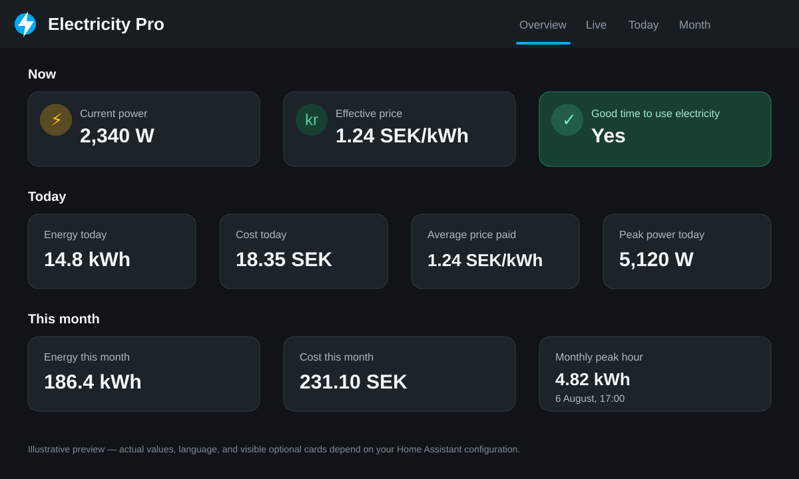
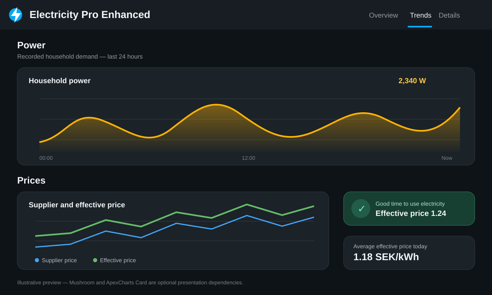

# Example dashboards

Electricity Pro includes a dependency-free standard dashboard and an optional
enhanced dashboard with richer presentation cards.

The enhanced dashboard never changes Electricity Pro calculations or entity
semantics. It is an optional presentation layer only.

Both examples label daily and monthly costs as supplier costs. Context notes
link to the full cost definitions instead of repeating them above the cards.
For local estimates, the notes show priced consumption and fixed-fee timing;
for partial monthly energy they show the tracking/reset timestamp. Older
unverified monthly totals are flagged without claiming that they are incorrect.

To see these presentation changes in an existing manually copied dashboard,
update its YAML from the appropriate example. Updating the integration alone
does not rewrite that dashboard. Sensor entity IDs and calculations are unchanged.

## Choose a dashboard

Household cost estimates are shown before the supplier-only breakdown.
They include observed effective variable costs plus accrued fixed fees; notes
identify partial periods, missing settings and excluded demand charges.
See [household cost estimates](../../docs/guides/costs-and-pricing.md#household-cost-estimates).

| Example | Choose it when | Dependencies |
| ------- | -------------- | ------------ |
| **Standard — recommended** | You want a reliable first setup using native Home Assistant cards | None |
| **Enhanced** | You want richer cards, combined price charts, and the forward-price chart | Mushroom and ApexCharts Card |

Begin with Standard unless the enhanced presentation is important to you and
its two frontend dependencies are already installed. Both examples use the same
Electricity Pro entities and can coexist as separate dashboards.

## Language versions

Both examples are available in English and Swedish:

| Example | English | Svenska |
| ------- | ------- | ------- |
| Standard | [English YAML](electricity-pro.yaml) | [Svensk YAML](electricity-pro-sv.yaml) |
| Enhanced | [English YAML](electricity-pro-enhanced.yaml) | [Svensk YAML](electricity-pro-enhanced-sv.yaml) |

Choose the YAML language explicitly. Hard-coded dashboard labels do not switch
when you change your Home Assistant profile language. Both versions use the same
entity IDs, card dependencies, conditions, chart data and example thresholds.
The Swedish versions also translate the advice, partial-coverage notes and known
missing-cost components. Their dates use `YYYY-MM-DD HH:MM`.

Swedish cost tiles use **Total kostnad (ca)** under the day/month heading, and
**Effektivt snittpris** for the consumption-weighted average Effective Price.
These compact dashboard labels retain the existing estimate/price definitions;
full entity names and coverage attributes remain available through More info.
Forecast pairs use **Billigaste 1h period** and **Snittpris 1h period** (also
2h/3h): the average price belongs to the paired cheapest period.
**Pristrend 2h** retains the same two-hour trend.

The sensor's price-direction states have English/Swedish frontend translations;
raw states remain `rising`, `falling` and `stable` for existing automations.
Entity state presentation follows the Home Assistant profile language, separately
from the chosen dashboard YAML. State translations require Electricity Pro
1.7.2 or newer and a restart. Other dashboard labels only require copying the
selected YAML.

**Svenska:** Välj svensk YAML ovan och följ installationsstegen nedan. Standard
använder enbart inbyggda kort; Enhanced kräver Mushroom och ApexCharts Card.
Använd svenska som profilspråk för svenska sensortillstånd. Kopiera YAML-filen
på nytt för att uppdatera en befintlig dashboard.
**Konsumptionspoäng** i Standard beskriver gårdagens förbrukningsmönster i
förhållande till elpriserna.

Keep the English and Swedish examples together when changing operational
settings. Automated parity checks protect entity references, conditions,
numeric/chart settings, JavaScript and template state reads/branches. Template
rendering tests cover both languages; visual layout still needs a frontend check.

## Quick installation

HACS installs the Electricity Pro integration but does not create or modify
Home Assistant dashboards. Installing either example takes about a minute:

1. Open the chosen source file and use GitHub's **Copy raw file** button:
   - Standard: [English](electricity-pro.yaml) / [Svenska](electricity-pro-sv.yaml)
   - Enhanced: [English](electricity-pro-enhanced.yaml) / [Svenska](electricity-pro-enhanced-sv.yaml)
2. In Home Assistant, open **Settings → Dashboards → Add dashboard**.
3. Choose **New dashboard from scratch**, give it a title such as
   **Electricity Pro**, enable **Show in sidebar**, and create it.
4. Open the dashboard, select **Edit dashboard**, and take control when
   prompted.
5. Open the three-dot menu and select **Raw configuration editor**.
6. Replace the editor contents with the copied YAML, then save and exit edit
   mode.
7. Confirm that the entity IDs match the Electricity Pro entities in your
   installation.

If a card reports that an entity does not exist, open **Settings → Devices &
services → Electricity Pro → Entities** and replace that entity ID in the
dashboard YAML. Home Assistant may assign an alternative suffix when an entity
name was already in use.

## Standard dashboard

`electricity-pro.yaml` contains four views:

- **Overview** — the most important live values and today's key figures
- **Live** — current power, spot, supplier, and Effective Price, plus recent
  history
- **Statistics** — today's energy, cost, average and peak power, peak time, the
  previous day's Consumption Timing Score, and this month's energy, cost, and
  peak-hour information
- **Forecast** — cheapest upcoming 1h, 2h and 3h windows, their average
  Effective Prices, next inexpensive hour, and near-term price direction

The Overview translates the Good Time binary state into actionable wording:
**Good time to use electricity** or **Wait for a better price**. Its tile shows
the current Effective Price rather than the localized `on` or `off` text.

The preview is illustrative. Values, language, and visible optional cards depend
on the entities configured in your Home Assistant installation.

### Set the live gauge scales

The built-in gauges use fixed example settings in Standard (Overview and Live)
and Enhanced (Overview). Use the units shown by your sensors.

| Gauge | Unit | Example range | Yellow from | Red from |
| ----- | ---- | ------------- | ----------- | -------- |
| Current Power | W | 0–10,000 | 4,000 | 7,000 |
| Effective Price | Currency/kWh | 0–3 | 1 | 1.5 |
| Current Cost Rate | Currency/h | 0–20 | 5 | 10 |

- **Current Power.** Choose a scale from your power history. For example, a
  home that usually imports under 2,000 W might use a 3,000 W maximum. A home
  that regularly charges an EV or uses electric heating might need a 12,000 W
  maximum. Set the color boundaries around the loads you want to notice.
- **Effective Price.** Choose a range that leaves room for expensive hours in
  your currency. In Fixed mode, the configured **Good price threshold** can
  guide your choice of yellow boundary. In Adaptive mode, use the separate
  **Good time to use electricity** indicator to see the current price assessment.
- **Current Cost Rate.** Choose `severity.red` independently in currency per
  hour, based on the hourly rate you want to notice. Then choose a lower
  `severity.yellow` and a `max` above the red boundary. At 6 kW and 1.50 SEK/kWh,
  the rate is 9 SEK/h. At 2 kW and 4.50 SEK/kWh it is also 9 SEK/h, even though
  the power and price gauges tell different stories.

Edit the card in Home Assistant or change `min`, `max`, and `severity` in the
dashboard YAML. Set `severity.green` to `min` and put yellow and red in
ascending order below `max`. In Standard, apply the same settings in both
Overview and Live. These are display settings. The card still shows the sensor's
numeric value when it falls outside the selected scale.

Lower `min` below zero if you want the needle to cover export on Current Power
or negative values on Effective Price and Current Cost Rate. A negative price
can produce a negative cost rate during import. During export, Current Cost
Rate is unavailable because it uses the import price. See
[signed power and cost rates](../../docs/reference/sensors.md#current-power-and-signed-flow).

Ändra `min`, `max` och `severity` i kortet eller i dashboardens
YAML. Välj en egen röd gräns (`severity.red`) för **Kostnad per timme just nu** i
din valuta per timme. Lägg gulgränsen under den och skalans max över den. Använd
samma värden i Översikt och Live i Standard.

## Requirements

### Optional production, export and household demand (experimental)

Both Overview views include independent Production, Grid export and Household demand groups
using built-in cards. They show configured power and partial daily/monthly
energy sensors; power-only and energy-only configurations are supported.
Energy tiles explicitly say **partial** and link to
[source and coverage details](../../docs/guides/production-export.md). Export is not
labelled solar export, household consumption, savings or revenue.

Household demand is shown only from explicitly selected non-storage load sources.
Its notes distinguish it from grid import and exclude battery charging.
These tiles do not substitute household energy for imported energy or alter
costs, existing statistics or recommendations.

The groups and their individual tiles hide absent or `unknown` entities.
Valid zero readings stay visible. `unavailable` readings also remain visible,
so an outage is not mistaken for no production/export. Tap a tile for history
and diagnostic attributes. A retained unavailable entity from a removed
configuration will still appear until that obsolete entity or its card is
removed. No additional frontend dependency is needed.

As with other [conditional cards](https://www.home-assistant.io/dashboards/conditional/),
exit dashboard edit mode before checking visibility. The existing SVG preview
illustrates an import-only home, so it does not include these optional groups.

### Existing optional measurements

Configure only the optional source sensors relevant to your home.
Outside the production/export groups, built-in conditional cards hide optional
entities whose state is `unknown` or `unavailable`. Home Assistant always shows
conditional cards while editing, so exit edit mode when verifying their visibility.

If Home Assistant assigned a different entity ID, replace that ID throughout
the YAML. Cards and complete views can be removed or reordered without changing
the integration.

## Card requirements

The example uses only built-in Home Assistant heading, grid, tile, conditional,
and history graph cards. No HACS frontend cards are required.

## Enhanced dashboard

`electricity-pro-enhanced.yaml` contains four views:

- **Overview** — insight, live values, and daily and monthly statistics
- **Trends** — recorded power history plus spot, supplier, and effective-price
  comparison
- **Details** — optional three-phase current and voltage measurements plus a
  six-hour raw power-detail chart
- **Forecast** — a forward spot-price chart and Mushroom presentation of the
  scheduling insights

### Required frontend dependencies

Install both optional dashboard packages through HACS before copying the
enhanced YAML:

1. [Mushroom](https://github.com/piitaya/lovelace-mushroom) — compact entity,
   title, and insight cards (`custom:mushroom-*`).
2. [ApexCharts Card](https://github.com/RomRider/apexcharts-card) — recorded
   power and price charts and the monthly variable cost chart (`custom:apexcharts-card`).

**Trends** includes an optional stacked variable cost chart with priced kWh and
coverage for the last twelve local calendar months. It appears after the
integration archives its first priced interval. To remove it, delete the
conditional block for `sensor.electricity_pro_monthly_variable_cost_history`.

HACS itself is not part of Electricity Pro. If either card is missing, Home
Assistant reports a custom element error; use the standard dashboard instead
until both dependencies are installed and their frontend resources are loaded.

### Enhanced dashboard installation

1. Install HACS according to the HACS documentation if it is not already
   available.
2. In HACS, open **Frontend**, find and install **Mushroom** and
   **ApexCharts Card**, then refresh the browser when prompted.
3. Create a new manual dashboard and open its raw configuration editor.
4. Replace its contents with `electricity-pro-enhanced.yaml` and save.
5. Exit edit mode and verify the **Overview**, **Trends**, and **Details**
   views.

The enhanced example displays recorded Electricity Pro entity history and the
forecast insights calculated by the integration. It does not create forecasts,
modify prices, or contain provider-specific calculations. Optional cards are
wrapped in built-in conditional cards and are hidden when their entities are
`unknown` or `unavailable`.

When a Nord Pool forecast source is configured, the Trends price chart adds the
raw spot price alongside the contracted supplier price and Electricity Pro's
effective price. These lines deliberately represent different scopes: spot
price is the underlying exchange price, supplier price includes VAT and supplier
markup, and effective price adds configured costs such as grid fees and energy
tax. The supplier line uses `sensor.electricity_pro_current_supplier_price`.
Its history starts when that sensor is installed. Update an existing manually
copied dashboard to use this entity instead of `sensor.electricity_pro_current_price`.
If the input includes inseparable grid charges or lacks VAT/markup information,
the supplier sensor is unavailable instead of showing the source as supplier price.

The Forecast view plots every spot-price interval retained by Electricity Pro
from the start of today through tomorrow, with a red **Now** marker. Before Nord
Pool publishes tomorrow's prices, normally around 13:00 local market time, the
unpublished part of the chart remains blank. The 50-hour display span also
accommodates daylight-saving transitions and does not imply that 50 hours of
prices are always available.

The forward chart uses ApexCharts Card's `data_generator` support and its default
source-entity-driven updates. It deliberately omits `update_interval`: interval
polling can leave ApexCharts Card 2.2.3 stuck on **Loading** during initialization
([upstream report](https://github.com/RomRider/apexcharts-card/issues/1120)).
If you copied an earlier Enhanced example, remove `update_interval: 1min` from
the **Spot price forecast** card; updating the integration alone does not
change a manually copied dashboard. Keep the other chart settings unchanged.
The **Now** marker advances when the chart updates, not on a separate
one-minute timer.

On 2026-11-03, the maintainer reported that removing this setting resolved
loading on the semi-production installation and also tested successfully on
mobile. This is a configuration workaround, not an upstream library fix.
The regression test checks that interval polling stays absent; it does not
exercise browser rendering. Further horizon/update checks are tracked in
[#224](https://github.com/guslund-jpg/electricity-pro/issues/224).

Its Overview view uses the same built-in gauges and
[editable scales](#set-the-live-gauge-scales) as the standard dashboard.

The Details view presents Current L1, L2, and L3 as comparable gauges. The
example assumes a 20 A main fuse: green below 14 A, yellow from 14 A, and red
from 18 A. All three gauges deliberately use the same scale so phase imbalance
is easy to see. Change each gauge's `max` and `severity` values together if the
installation has a different main-fuse rating.

Below the voltage readings, the six-hour Power Detail chart retains the
individual recorded power readings instead of averaging them into five-minute
groups. Use it to inspect whether a high reading is a brief transient or a
sustained load. The 24-hour Trends chart remains five-minute averaged for a
clearer overview, so short peaks can appear lower or be hidden there.

## Customization

For either dashboard, replace entity IDs if Home Assistant assigned different
names. You can remove cards for features you do not configure, adjust graph
spans and grouping intervals, or reorder views without changing Electricity
Pro itself.
